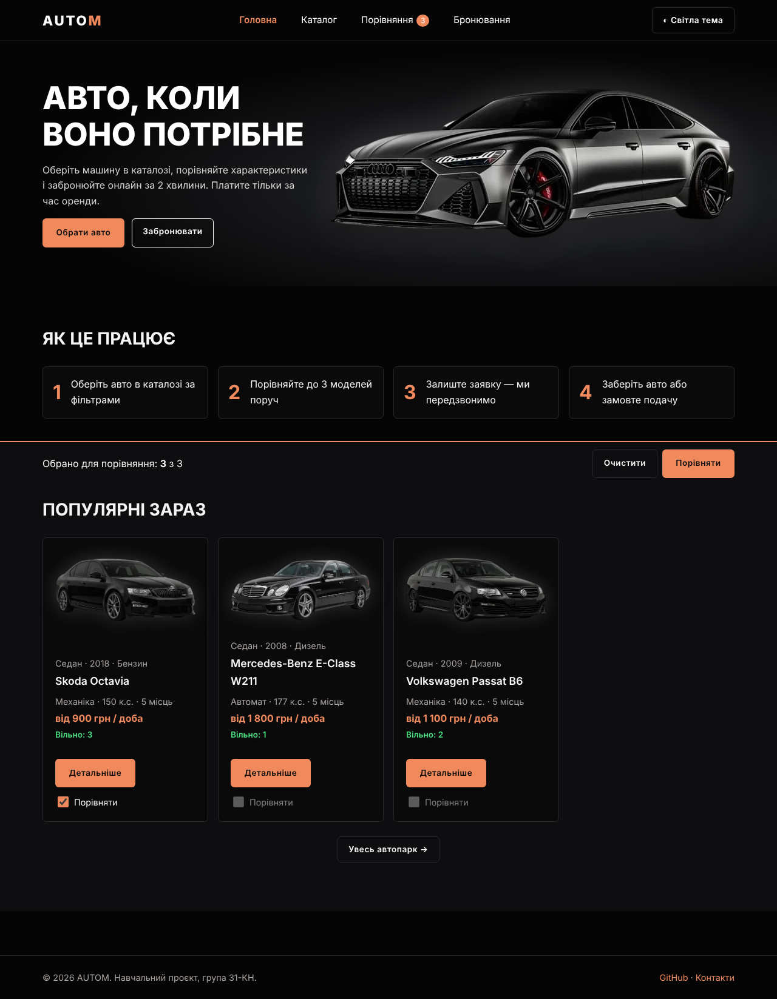
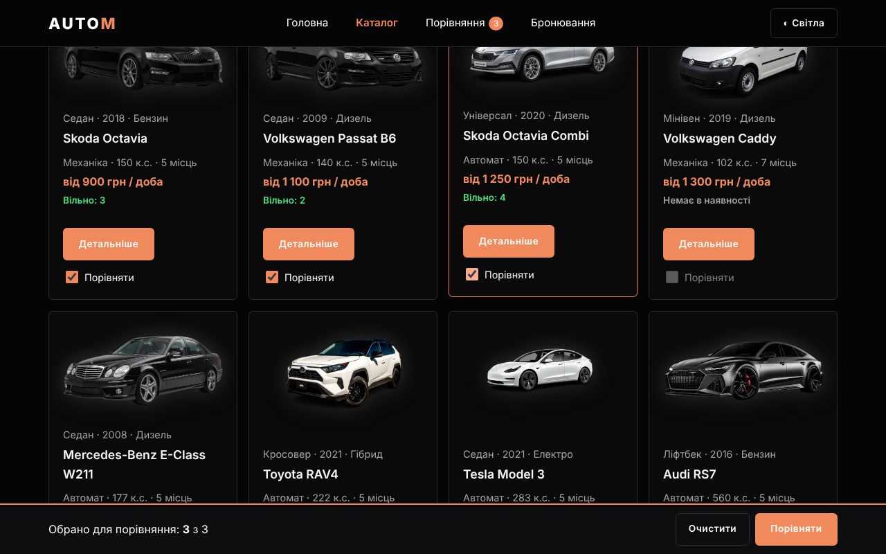
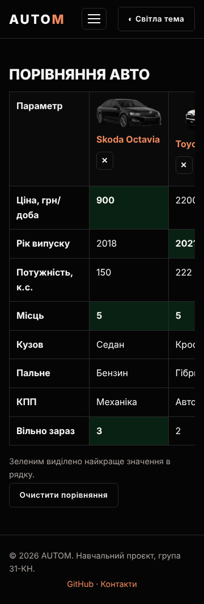

# AUTOM: прокат і каршерінг авто

Навчальна практика з дисципліни «WEB-технології та WEB-дизайн», ВСП Івано-Франківський фаховий коледж, група 31-КН.
Варіант 17 «Автосалон / прокат авто»: каталог авто з фільтром за кількома параметрами і порівнянням, сторінка авто, бронювання, власний REST API.

## Посилання

- Сайт: https://carsharing-green.vercel.app/
- Репозиторій: https://github.com/melya654/CarSharing
- Figma (практика): https://www.figma.com/design/Ly1kO2Aacn6sai12bjHF3c/нп
- Figma (лендінг з практичних): https://www.figma.com/design/21qgQXsHzVqehUcnhd26Uz/melnik-zvit

## Стек

- Клієнт: React 19, Vite, React Router, CSS custom properties (токени з Figma), mobile-first
- Сервер: Node.js, Express 5, cors, dotenv, дані в JSON (fs/promises)
- Тести: Vitest, React Testing Library
- PWA: manifest, service worker, офлайн-сторінка
- Деплой: Vercel (автодеплой з main)

## Скриншоти

| Головна | Каталог з порівнянням | Порівняння (360 px) |
|---|---|---|
|  |  |  |

## Локальний запуск

```bash
# 1. API
cd server
npm install
cp .env.example .env
npm start                 # http://localhost:3000

# 2. Клієнт (в іншому терміналі)
cd client
npm install
cp .env.example .env      # VITE_API_URL=http://localhost:3000
npm run dev               # http://localhost:5173

# тести і збірка
npm test
npm run build
```

Без `VITE_API_URL` клієнт бере дані з `client/public/cars.json`, тому сайт працює і на статичному хостингу.

## Структура

```
client/                 React-застосунок (Vite)
  src/components/       Header, Footer, Button, ThemeToggle, CarCard, CarList, Filters,
                        CompareBar, Modal, ContactForm, Loader
  src/pages/            Home, Catalog, CarDetails, Compare, Contacts, Admin, NotFound
  src/hooks/            useFetch, useCompare
  src/utils/            filterCars, validation, useTitle
  src/tests/            тести Vitest
  public/               cars.json, зображення, manifest, sw.js, robots.txt, sitemap.xml
server/                 Express API (CRUD /api/cars, /api/contact)
docs/                   TZ, UX, API, AI, AUDIT, Lighthouse-звіти, Postman
index.html, script.js   статична версія з практичних (HTML/CSS/JS)
portfolio-react/        перша React-версія з практичних
```

## Дерево компонентів

```
App
├── Header
│   └── ThemeToggle
├── Routes
│   ├── Home ── CarList ── CarCard
│   ├── Catalog ── Filters, CarList ── CarCard
│   ├── CarDetails
│   ├── Compare
│   ├── Contacts ── ContactForm ── Modal
│   ├── Admin
│   └── NotFound
├── CompareBar
└── Footer
```

## Документація

- [docs/TZ.md](docs/TZ.md): технічне завдання
- [docs/UX.md](docs/UX.md): персони, user stories, дизайн-система, промпти
- [docs/API.md](docs/API.md): ендпоінти
- [docs/AUDIT.md](docs/AUDIT.md): Lighthouse до/після, чек-лист, тести
- [docs/AI.md](docs/AI.md): як використовував AI
